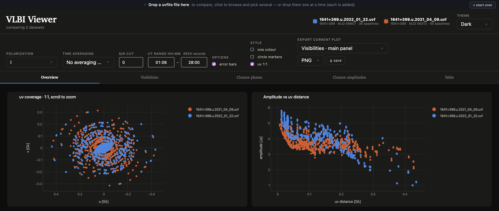

# VLBI Viewer

An interactive browser dashboard for looking at the visibility data in a VLBI uvfits file: amplitudes and phases per baseline with their uncertainties, uv coverage, and closure phases / closure amplitudes over non-redundant triangles and quadrangles.

The dashboard allows to inspect a single dataset or to compar multiple ones.

It is also possible to save the displayed figures with the current plotting settings.

## User Guide

##### Create the environment

From inside the repository run the following:

```bash
conda env create -f environment.yaml
conda activate vlbiviewer
```

##### Launch the dashboard.

###### Option 1. 

1. Double-click **`launch.command`** (macOS/Linux) or **`launch.bat`** (Windows) which launches the app and opens the browser at `http://127.0.0.1:8050`. 
2. Drag a uvfits file onto the page, or click the drop zone to browse for one. Once a file is loaded a slim bar stays at the top, so you can drop another uvfits to switch files without restarting. Note: Safari requires to load only one file at a time.

###### Option 2. 

From the terminal run any of the following: 

```bash
python vlbi_viewer.py                             # opens the browser on a drop zone
python vlbi_viewer.py path/to/observation.uvfits  # loads one file 
python vlbi_viewer.py obs1.uvfits obs2.uvfits     # loads multiple files
python vlbi_viewer.py --no-browser                # start the server only
```

## Tabs

- **Overview** — a summary page with: uv coverage, amplitude vs uv distance, amplitude and phase vs time for all baselines, closure phase and log closure amplitude vs time.
- **Visibilities** — pick any subset of baselines and stack the panels you want (amplitude, phase, σ amplitude, σ phase, S/N, real, imaginary) againstnUT time or uv distance; overlay all baselines or give each its own panel. A collapsible uv-coverage panel highlights the current selection.
- **Closure phases** — every closure phase vs time, with errors.
- **Closure amplitudes** — log (or linear) closure amplitude vs time.
- **Table** — the data table, sortable and filterable, with a CSV download.

## Demo

https://github.com/user-attachments/assets/84f9e55a-eb2c-4e6e-accd-c36b0028d74d

## Files

| fil | purpose |
|---|---|
| `uvdata.py` | reads files and computes data products |
| `figures.py` | makes figures with plotly |
| `vlbi_viewer.py` | the dash application |
| `assets/style.css` | styling |
| `environment.yaml` | environment with required packages |
| `launch.command` / `launch.bat` | double-click launchers (macOS-Linux / Windows) |

## Disclaimer

I created the VLBI Viewer tool as an exercise to familiarize myself with AI-based coding. I'm sharing it here because I think it can be useful for other researchers working with VLBI data. I recommend thoroughly checking the code in case the user wants to use any plot made by the VLBI Viewer in a scientific publication.
The code was built using [eht-imaging](https://github.com/achael/eht-imaging/)'s utilities as a reference for data manipulation.





